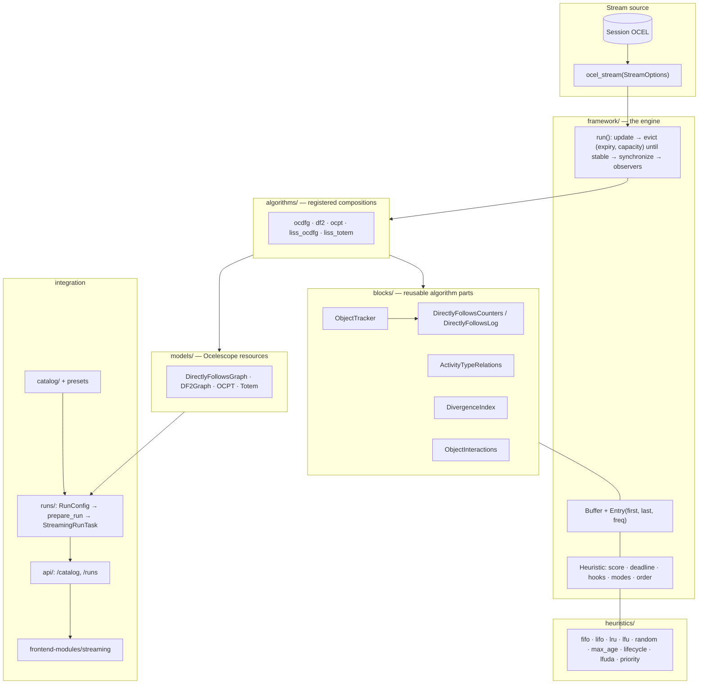

# Architecture

The streaming module replays an object-centric event log as a stream and runs
**streaming discovery algorithms** on it. Everything an algorithm remembers is
stored in **buffers**; an **eviction heuristic** decides which buffer entries
are forgotten, and when. Algorithms and heuristics are independent of each
other, so every heuristic can be compared on every algorithm.

The formal definitions behind this document are in
[`definitions.tex`](definitions.tex). Code docstrings refer to its labels
(e.g. `def:run`).

## Packages

All paths below are relative to `backend-modules/streaming/src/ocelescope_module_streaming/`.

| Package | Contents | May import |
|---|---|---|
| `stream/` | Stream items (`Event`, `O2OUpdate`, `AttributeUpdate`, `StreamItem`), `StreamOptions`, `well_formed` | standard library |
| `framework/` | `Buffer`, `Entry`, `BufferConfig`, `Heuristic`, `Context`, eviction modes/orders/reasons, `StreamingAlgorithm`, `run`, `Observer` | `stream/` |
| `heuristics/` | Built-in eviction heuristics, registered in the catalog | `framework/`, `catalog/` |
| `blocks/` | Reusable algorithm parts with their own buffers | `framework/`, `stream/` |
| `models/` | Builders from block snapshots to Ocelescope resources, the OCPT cut miner | `ocelescope`, `blocks/` |
| `algorithms/` | Registered algorithms, their offline references and comparisons | all of the above, `ocelescope` |
| `catalog/` | Registries of algorithms and heuristics (`register_algorithm`, `register_heuristic`) | `framework/` |
| `runs/` | `RunConfig`, validation (`prepare_run`), presets, background runs (`StreamingRunTask`) | everything, `ocelescope_backend` |
| `evaluation/` | Run observers: progress, buffer statistics | `framework/` |
| `api/` | FastAPI routes `/catalog` and `/runs` | `runs/`, `catalog/` |
| `ocel.py` | Replay of an Ocelescope OCEL as a stream | `ocelescope`, `ocelescope_backend` |
| `module.py` | The Ocelescope module: app, routes, resource types | everything |

Keep `stream/`, `framework/`, `heuristics/` and `blocks/` free of Ocelescope
imports: they are the research core and must run without the backend.

## The stream

`ocel_stream(ocel, options)` replays a log as `StreamItem(x, t)` pairs:

- Items are ordered by timestamp; equal timestamps are ordered events, then
  attribute updates, then O2O updates, then by identifier. Every replay of the
  same log yields the same order.
- O2O relations have no timestamp in OCEL 2.0. Each one is placed at the first
  event of its source object; relations whose source has no event are skipped.
- Events without objects are skipped.
- `StreamOptions` selects the item kinds. Each algorithm declares a default
  (e.g. events only for the OCPT miner); the run configuration may override it.

The **position** of an item (1, 2, …) is the only notion of time used for ages
and deadlines. On an events-only stream, positions are event indices.

## Buffers and entries

A `Buffer` is a key–value store. For every key it keeps an `Entry` with the
value and its bookkeeping: `first` and `last` (positions of the first and last
write) and `freq` (number of writes).

- `put(key, value)` writes a key and marks it as **touched** for the current
  item. Touched keys are never evicted while that item is processed.
- `append(value)` writes under a fresh integer key. Buffers used this way are
  *observation logs*: each entry is one observation (Liss et al.).
- `discard(key)` removes a key without eviction handling (reason `discarded`),
  e.g. dependent entries.
- `get`, `entry`, `items`, `len`, `in` only read.

## Eviction modes

A buffer's `BufferConfig(capacity, heuristic, mode)` selects one of:

| Mode | Behaviour | Heuristic must implement |
|---|---|---|
| none (no heuristic) | never evicts | – |
| `capacity` | at most `capacity` entries; the highest score goes first | `score` / `scores` (or an `order`) |
| `expiry` | no size limit; each key has a scheduled deadline | `deadline` |
| `both` | expiry first, then capacity | both |

If `mode` is omitted it is derived: `capacity` when a capacity is set,
otherwise `expiry` when a heuristic is set. A heuristic declares the modes it
supports in `modes`; invalid combinations are rejected when the run is
prepared.

**Expiry is scheduled.** When a key is written, the heuristic's
`deadline()` is stored. Once that position is reached, the deadline is
recomputed: if it now lies in the future, the key is rescheduled; otherwise
it is evicted. A deadline that shrinks after scheduling does not evict
earlier. This is the semantics of the online OCPT paper.

## The run loop

`run(algorithm, stream, observers)` processes each item in four steps
(`def:run`):

1. **Update.** Every buffer's heuristic sees the item (`on_item`), then the
   algorithm processes it (`update`). Afterwards each heuristic is told about
   the keys written in its buffer (`on_write`) and, in expiry mode, schedules
   them.
2. **Evict**, buffer by buffer in the order of `algorithm.buffers`: expired
   keys first, then keys by score while the buffer is over capacity. Each
   eviction calls `algorithm.finish(buffer, key, value)` (which may write to
   other buffers, e.g. to record an end activity), then
   `heuristic.on_evict`, then `observer.on_evict`. Because `finish` may refill
   a buffer that was already handled, this step repeats until no buffer
   evicts.
3. **Synchronize.** `algorithm.after_evictions(position)` may discard keys,
   e.g. Liss et al.'s coupled removal.
4. **Observe.** `observer.on_item` is called.

The model after the last item is `algorithm.model()`.

**Exactness.** If no key is evicted *too early* (written again later), and
evicting a key does not change the model, a bounded run yields the same model
as the unbounded run (Prop. `prop:exact`). `BufferMonitor` counts premature
evictions per buffer.

**Memory** is measured in buffer entries: after each item, a buffer holds at
most `max(capacity, keys touched by the item)` entries.

## Built-in algorithms

| Key | Model | Buffers | Paper |
|---|---|---|---|
| `ocdfg` | OC-DFG (`DirectlyFollowsGraph`) | objects, arcs, starts, ends | counters; end activities from evicted and live objects |
| `df2` | `DF2Graph` | + activities, relations, divergence, divergent | Mühlmeyer et al. 2026 |
| `ocpt` | `OCPT` (process tree, inductive miner on the DF2 graph) | as `df2` | Mühlmeyer et al. 2026 |
| `liss_ocdfg` | OC-DFG | objects, arcs (observation log) | Liss et al. 2025 |
| `liss_totem` | `Totem` | lifespans, log_cardinality, event_cardinality | Liss et al. 2025 |

Every algorithm has an offline reference computed from the complete log and a
comparison that scores the streaming model against it. Without eviction, each
streaming model equals its offline reference (tested on `container_logistics`).

## Built-in heuristics

| Key | Modes | Idea |
|---|---|---|
| `fifo` | capacity | oldest key first (constant time) |
| `lifo` | capacity | newest key first (constant time) |
| `lru` | capacity | least recently written first (constant time) |
| `lfu` | capacity | least frequently written first |
| `random` | capacity | random key (seeded) |
| `lfuda` | capacity | LFU with dynamic aging (Liss et al.) |
| `priority` | capacity | a cache policy combined with an object-type characteristic (Liss et al.) |
| `max_age` | expiry | evict `age` positions after the last write |
| `lifecycle` | expiry | Bayesian end-activity schedule between `t_hint` and `t_max` (Mühlmeyer et al.) |

## Presets

Presets (`runs/presets.py`) are run configurations of the published
techniques. The catalog lists them and the frontend copies them into its form,
so every stored run has an explicit configuration.

| Key | Configuration |
|---|---|
| `muehlmeyer2026-exact` | `ocpt`, all buffers unbounded |
| `muehlmeyer2026` | `ocpt`, objects: `lifecycle(200, 2000)`, divergence index: `max_age(2000)` |
| `liss2025-ocdfg` | `liss_ocdfg`, both buffers FIFO with 1000 entries |
| `liss2025-totem` | `liss_totem`, all buffers FIFO with 1000 entries |

## Integration with Ocelescope

- `module.py` defines the module `Streaming` (key `streaming`), registers the
  resource types `DF2Graph`, `OCPT` and `Totem`, and mounts the API under
  `/modules/streaming/v1`.
- `GET /catalog` lists algorithms (with buffers, default stream and parameter
  schema), heuristics (with supported modes and parameter schema) and presets.
  The frontend builds its forms from these schemas, so new algorithms,
  heuristics and parameters appear without frontend changes.
- `POST /runs` validates a `RunConfig` and starts a `StreamingRunTask` on a
  background thread. The streaming model and the offline reference are added
  to the session as resources; the run summary holds the scores per element
  kind and the statistics per buffer (sizes, evictions per reason, premature
  evictions).
- The frontend module (`frontend-modules/streaming`) has one page: a run form
  (preset, algorithm, stream items, per-buffer eviction mode, capacity,
  heuristic and parameters) and a canvas showing the streaming model, the
  offline model or both, with scores and buffer statistics.
